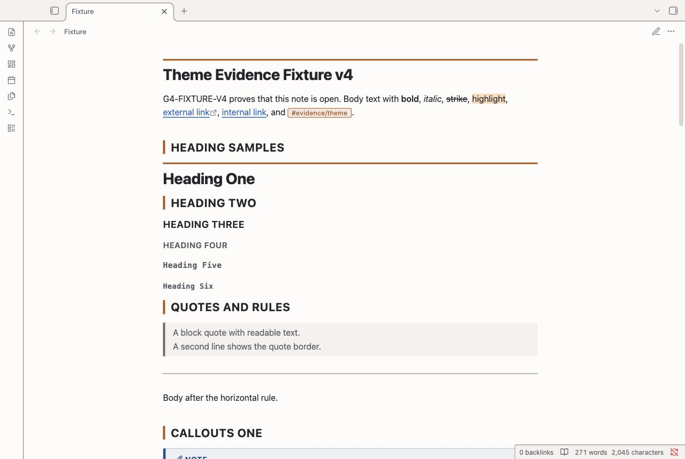
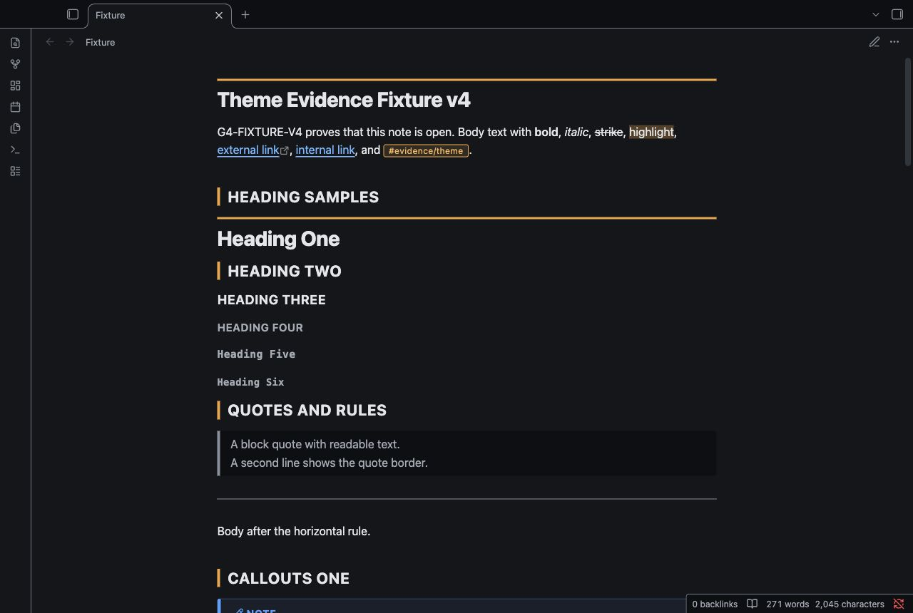
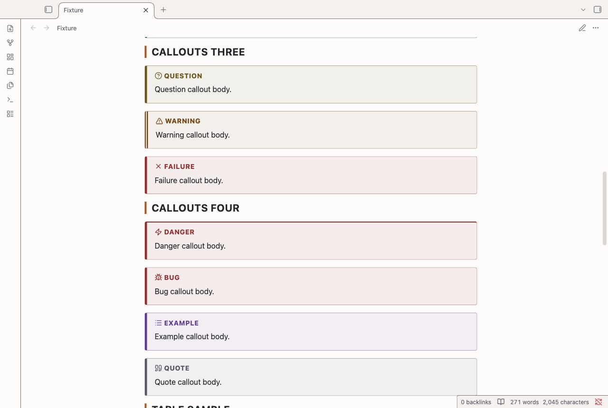
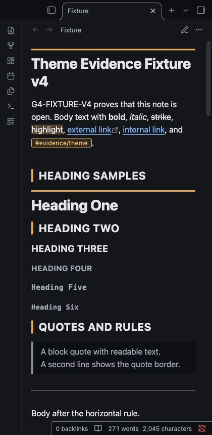

# Incident Review

Incident Review is an Obsidian theme for postmortems, incident timelines, and on-call notes.
Amber section bars mark review stages. Compact tables keep status records easy to scan.
Callouts use type colors on their title, icon, tint, and severity stripe. Monospace details suit logs and timestamps.
Light mode uses warm paper colors. Dark mode uses a charcoal background.

## Screenshots

These images show the desktop renderer with a test note.






## Install

1. Download `theme.css` and `manifest.json` from this repository.
2. Open your vault folder.
3. Create the folder `.obsidian/themes/Incident Review/`.
4. Put both files in that folder.
5. Open Settings, then Appearance in Obsidian.
6. Select **Incident Review** in the theme list.

Use the manifest name for the install folder. The repository name is not the install folder name.

## Uninstall

1. Select the default theme in Settings, then Appearance.
2. Remove `.obsidian/themes/Incident Review/` from the vault.

The theme does not change note text.

## Compatibility

The manifest requires Obsidian 1.1.0 or later.
The desktop renderer was tested with Obsidian 1.14.4.
The oldest declared app version was not tested. The theme does not use `:has()`.
Mobile use was not tested. A narrow desktop capture does not test a mobile device.
Community plugin views and screen readers were not tested.

## Customization

Add a CSS snippet in Settings, then Appearance to override theme variables.
For example, this snippet adds space between text lines:

```css
body {
  --line-height-normal: 1.7;
  --font-text-size: 16px;
}
```

The `--ir-accent` variable controls amber rails and markers.
The `--ir-bg`, `--ir-ink`, and `--ir-rule-strong` variables control backgrounds, text, and borders.
Set these variables under `.theme-light` or `.theme-dark` in your snippet.
Check contrast after a color change.
This theme does not include Style Settings controls.

## Known limits

- H2 to H4 labels, callout titles, and table headers use uppercase letters. Tags keep their case. This can change the appearance of case-sensitive identifiers in headings.
- Long code lines and wide tables can require horizontal scrolling in narrow panes.
- Severity callouts style existing Obsidian callout types. They do not assign incident severity or add a workflow.
- The theme uses system fonts. Timestamp widths can differ between operating systems.
- Custom CSS snippets can override the focus ring or reduce text contrast.

## License

[MIT License](LICENSE). Copyright (c) 2026 U3 Theme Factory.
NoteMods maintains this theme. The original copyright notice remains in LICENSE.
